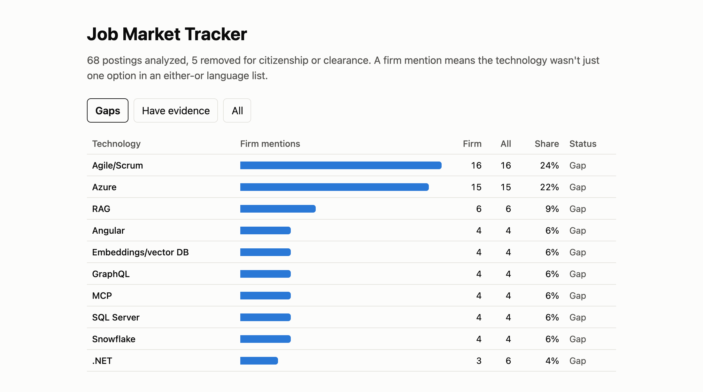
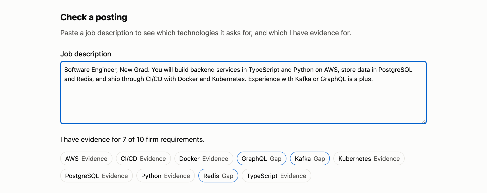
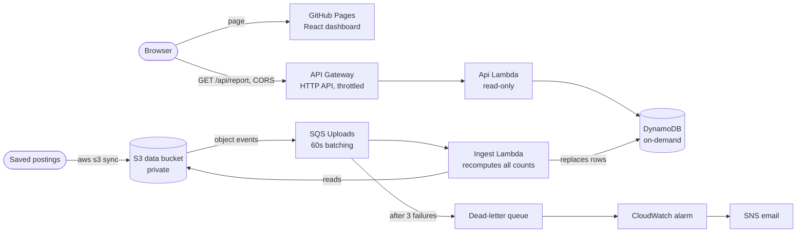

# Job Market Tracker

Shows which technologies appear most in the entry-level software job postings I've saved, and which ones I don't have evidence for yet.

**Live:** https://lhchi04.github.io/job-market-tracker/

Built with TypeScript, React, AWS Lambda, API Gateway, DynamoDB, S3, SQS, CloudWatch and AWS CDK, with the dashboard on GitHub Pages.



## Why I built this

I'm a new grad applying to software jobs every day, and I wanted to decide what to learn next from data instead of guesses. I saved the postings I applied to and counted which technologies they ask for:

- **Firm requirements vs. options.** "Java, Python, or Go" doesn't require Go, so mentions that only appear in an either-or language list are counted separately.
- **Roles I can't take are excluded.** Postings that require citizenship or a security clearance are filtered out.
- **Gaps are tracked against real work.** Each technology is marked as a gap until I have a project or job behind it.

The biggest technical gaps were AWS and TypeScript, so this project is built with them.

## What it does

- **Dashboard:** ranks technologies by how many postings firmly require them, filtered by gaps or evidence.
- **Check a posting:** paste any job description to see which technologies it asks for and which ones I have evidence for. It runs in the browser, and the text is never sent anywhere.



## Results

Measured on 2026-11-12 against the deployed stack:

| Metric | Result |
|---|---|
| Postings analyzed | 68 (5 more filtered for citizenship or clearance) |
| Full recompute of every posting | 1.0–3.9 s per Ingest run, at most 126 MB of memory |
| API latency, warm | 175 ms median, 276 ms p95 (30 requests to us-east-2 from my laptop) |
| Lighthouse performance | 99 mobile (median of 3 runs), 100 desktop |
| Page size | 91 KiB |
| Tests | 45 Vitest tests across all four packages |

## Architecture



Everything on the AWS side is defined in `packages/infra` with CDK.

## Design decisions

**Recompute everything on each upload.** Ingest rereads all postings and replaces the counts, instead of updating them one posting at a time. With 68 postings this takes under 4 seconds, and it makes every run idempotent, so retries and reruns are always safe. An SQS queue with a 60-second batching window folds a bulk upload of many files into one run, and concurrency is capped at 2.

**GitHub Pages instead of CloudFront.** The original design served the page and the API from one CloudFront domain. AWS declined CloudFront access for this new account, so the dashboard moved to GitHub Pages and calls the API directly. CORS allows only the dashboard's origin. The cost is no CDN in front of the API, which doesn't matter at this traffic.

**The posting check runs in the browser.** It reuses the same `core` package as the backend, so the dashboard and the checker can't disagree. Running it client-side means pasted text never leaves the page, and there's no public endpoint to abuse or pay for.

**Costs stay near zero by design:**
- DynamoDB is on demand, and there's no VPC, NAT gateway or database server.
- The API is throttled to 10 requests per second, with bursts of 20.
- Logs are kept for two weeks.

**Least privilege, enforced by tests.** The API Lambda can only read the table. Infrastructure tests fail if it gains write access, if a bucket becomes public, or if CloudFront comes back.

**Failures are visible.** An Ingest run that fails three times lands in a dead-letter queue, and a CloudWatch alarm emails me through SNS.

**Backend deploys are manual for now.** The dashboard deploys from GitHub Actions on every merge to `main`. Deploying the backend the same way needs an IAM OIDC role, which this account's Free plan blocks. I chose manual `cdk deploy` over storing long-lived AWS keys in GitHub.

## Testing

- **`core`:** technology matching edge cases, such as Go vs. "go", C vs. C++ vs. C#, either-or lists and reposts.
- **`functions`:** the Lambdas, against stubbed AWS clients.
- **`web`:** the dashboard and posting check, in jsdom.
- **`infra`:** the synthesized CloudFormation template.

Recent features were written test-first: the commit history shows a failing-test commit before each implementation. CI runs typecheck, tests and the build on every pull request.

## Layout

| Path | Contents |
|---|---|
| `packages/core` | Technology matching and counting |
| `packages/functions` | The API and ingestion Lambdas |
| `packages/web` | React dashboard |
| `packages/infra` | CDK stack |

## Develop

```sh
nvm use
npm ci
npm test
npm run typecheck
```

`npx tsx scripts/report.ts <dir>` prints the analysis for a local folder of postings.

Real postings are not in this repo. Tests use synthetic text. See [docs/aws-setup.md](docs/aws-setup.md) to deploy.
